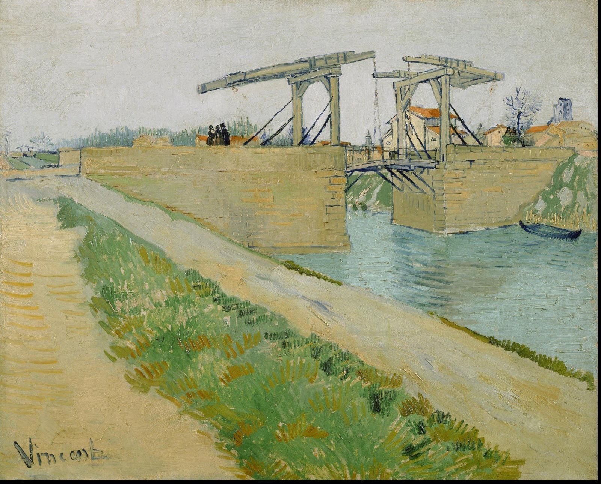
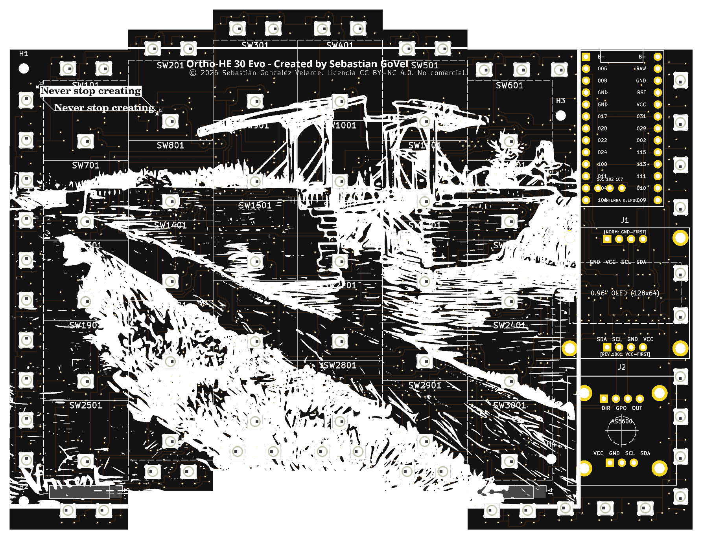

# ESPECIFICACIÓN MAESTRA DE IMPLEMENTACIÓN — ITERACIÓN V6.0 (TOP-TIER SHOWCASE)
**Destinado al Agente Constructor (Gemini Flash) & Auditoría Técnica**  
**Fecha:** 2 de Noviembre, 2026  
**Proyecto:** *FloatForce HE-Keyboard (Van Gogh Drawbridge Edition)* — Micrositio de Presentación para el Fondo 1517 (Medici Project)  
**Ubicación del código fuente del sitio:** `/home/sebas/HE_Keyboard_Plan/dist_site/`  
**URL de despliegue en GitHub Pages:** `https://sebas-govel.github.io/HE_KB_Showcase/`

---

## 1. RESUMEN EJECUTIVO DE LA ITERACIÓN V6.0

Esta iteración eleva el sitio web de presentación a un nivel estético, editorial y de ingeniería de clase mundial:
1. **Hero Monumental con PCB Transparente y Superposición Artística de Van Gogh:**
   - La PCB Rev A (`HE_KB_RevA.kicad_pcb`) se renderiza en altísima resolución con **fondo 100% transparente** y recorte automático de bordes vacíos, eliminando el marco oscuro cuadrado y pequeño.
   - Se incorpora la pintura original al óleo de Vincent van Gogh (*"El puente de Langlois en Arlés"*, 1888; ubicada en `real_life_videos_and_photos/20 - 3jzhiSF.jpg`) en una experiencia interactiva fluida (*"Canvas to Copper"*), donde el usuario puede alternar o deslizar suavemente entre la pintura original a todo color y la serigrafía vectorial en blanco y oro ENIG sobre la PCB negro mate.
   - Se refina el titular principal (`<h1>`) con un tono editorial de alta poesía y convicción humanista.
2. **Eliminación Total del Bloque 3D Redundante en el Hero y Botón Rayos X:**
   - Se retira el contenedor 3D secundario del Hero (`#hero3DContainer`, `lines 324–365`) y el botón `Toggle X-Ray` (`#btnHeroXray`), liberando 1 contexto WebGL completo y agilizando la carga inicial del sitio. El visor 3D maestro y definitivo es el de la Sección 02 (*"Van Gogh’s Drawbridge Metaphor / Tenting Ergonomics"*), donde el teclado se eleva de 0° a 25°.
3. **Honestidad Técnica en la Prueba de Concepto (`#real-life` — "¿What's actually real?"):**
   - Se actualiza la narrativa del macropad funcional de 16 teclas: sirvió para validar la mecánica del switch y la lectura analógica continua, pero **mostró en la práctica la susceptibilidad a la capacitancia parasítica, diafonía (cross-talk) entre cables volantes y la ausencia de desacoplo local**. Esta lección directa justificó y definió la arquitectura de la **PCB Rev A** (desacoplo de 100 nF por sensor, división de bus con 2x TMUX1308 que reduce capacitancia en 34%, plano de masa continuo y filtrado de asentamiento).
4. **Corrección de Espaciado Físico (Ergonomic Pitch `18 × 17 mm`, NO `Standard 19 mm`):**
   - El layout físico verificado en CAD (`KE_KB_Hardware/build_unibody_case.py` y KiCad) es de **`18.00 mm` entre columnas (X) y `17.00 mm` entre filas (Y)** (espaciado compacto ergonómico estilo Choc para switches de 12×12 mm), no el estándar MX de 19 mm. Se corrigen `index.html`, el diccionario i18n (4 idiomas) y `ENGINEERING_FACT_SHEET.md`.
5. **Integración Total en los 4 Idiomas (EN, ES, FR, DE):**
   - Todo cambio de texto en `index.html` debe reflejarse en los 4 diccionarios de `window.translations` para evitar desincronizaciones al cambiar de idioma.

---

## 2. GENERACIÓN Y PREPARACIÓN DE ACTIVOS GRÁFICOS

### 2.1. Render de Alta Resolución con Fondo Transparente de la PCB Rev A
El agente constructor debe ejecutar los siguientes comandos para renderizar la PCB en resolución 4K con canal alfa transparente y recortar el espacio sobrante:

```bash
# 1. Renderizar PCB Top en KiCad 10 con fondo transparente y colores reales de stackup
kicad-cli pcb render \
  --width 2400 --height 1800 \
  --side top \
  --background transparent \
  --use-board-stackup-colors \
  -o /home/sebas/HE_Keyboard_Plan/dist_site/assets/img/pcb_top_transparent.png \
  /home/sebas/HE_Keyboard_Plan/Hardware/kicad/HE_KB_RevA.kicad_pcb

# 2. Renderizar PCB Isométrica en KiCad 10 con fondo transparente
kicad-cli pcb render \
  --width 2400 --height 1800 \
  --rotate "-45,0,45" \
  --side top \
  --background transparent \
  --use-board-stackup-colors \
  -o /home/sebas/HE_Keyboard_Plan/dist_site/assets/img/pcb_iso_transparent.png \
  /home/sebas/HE_Keyboard_Plan/Hardware/kicad/HE_KB_RevA.kicad_pcb

# 3. Recortar bordes vacíos transparentes con Python (PIL) para que ocupe el 98% del marco visual
python3 -c "
from PIL import Image
for name in ['pcb_top_transparent.png', 'pcb_iso_transparent.png']:
    p = f'/home/sebas/HE_Keyboard_Plan/dist_site/assets/img/{name}'
    im = Image.open(p)
    bbox = im.getbbox()
    if bbox:
        cropped = im.crop(bbox)
        # Añadir un margen suave de 24px
        padded = Image.new('RGBA', (cropped.width + 48, cropped.height + 48), (0,0,0,0))
        padded.paste(cropped, (24, 24))
        padded.save(p, 'PNG')
        print(f'Optimizado {name}: {padded.size}')
"
```

### 2.2. Optimización Web de la Pintura de Van Gogh (*El puente de Langlois en Arlés*, 1888)
El archivo fuente original se ubica en `/home/sebas/HE_Keyboard_Plan/real_life_videos_and_photos/20 - 3jzhiSF.jpg` (2498 × 2016 px, 1.3 MB).  
El agente debe generar una versión optimizada para web en `/home/sebas/HE_Keyboard_Plan/dist_site/assets/img/vangogh_bridge_1888.jpg` (~220 KB):

```bash
python3 -c "
from PIL import Image
src = '/home/sebas/HE_Keyboard_Plan/real_life_videos_and_photos/20 - 3jzhiSF.jpg'
dst = '/home/sebas/HE_Keyboard_Plan/dist_site/assets/img/vangogh_bridge_1888.jpg'
im = Image.open(src)
im.thumbnail((1600, 1600), Image.Resampling.LANCZOS)
im.save(dst, 'JPEG', quality=86, optimize=True)
print(f'Van Gogh Web asset listo: {im.size}')
"
```

---

## 3. REDISEÑO DEL HERO (SECCIÓN MONUMENTAL & SUPERPOSICIÓN DE ARTE)

### 3.1. Nuevo Titular Editorial (`<h1>`)
Reemplazar el texto en `dist_site/index.html` y en `window.translations` por la siguiente estructura de impacto humano y estético:

- **Inglés (Primary):**
  ```html
  <h1 class="text-4xl sm:text-5xl lg:text-6xl font-serif text-ink-primary tracking-tight leading-[1.12]" data-i18n-html="hero_title">
    Humans express far more than 1 and 0.<br>
    <span class="italic font-normal text-accent-terracotta">FloatForce</span> gives everyone a way to feel everything in between.
  </h1>
  ```
- **Español (ES):**
  ```text
  Los seres humanos expresamos mucho más que 1 y 0.<br><span class="italic font-normal text-accent-terracotta">FloatForce</span> nos devuelve el tacto y los matices que existen en medio.
  ```
- **Francés (FR):**
  ```text
  Les humains expriment bien plus que des 1 et des 0.<br><span class="italic font-normal text-accent-terracotta">FloatForce</span> offre à chacun la liberté d'en ressentir toutes les nuances.
  ```
- **Alemán (DE):**
  ```text
  Der Mensch drückt weit mehr aus als 1 und 0.<br><span class="italic font-normal text-accent-terracotta">FloatForce</span> gibt jedem die Freiheit, jede Nuance dazwischen zu spüren.
  ```

### 3.2. Eliminación del Bloque 3D Redundante en el Hero
En `dist_site/index.html`:
1. **Eliminar el botón X-Ray:** Suprimir las líneas correspondientes a `#btnHeroXray` (líneas 264–267 y 340–343).
2. **Eliminar el contenedor 3D:** Suprimir por completo el bloque:
   ```html
   <!-- Líneas 324 a 365 -->
   <div class="mt-20 pt-16 border-t border-paper-border/80">
     ...
     <div id="hero3DContainer" ...>
     ...
   </div>
   ```
3. **Eliminar el script de Three.js del Hero:** En el `<script type="module">`, eliminar la función `initHero3D()`, sus variables globales (`heroScene`, `heroCamera`, `heroRenderer`, `heroControls`, `heroLeftHalf`, `heroRightHalf`, etc.), el listener de `btnHeroXray`, y remover `initHero3D();` del evento `DOMContentLoaded`.
4. **Limpieza de claves i18n:** Retirar de `window.translations` (en los 4 idiomas) las claves huérfanas: `hero_btn_xray`, `hero_3d_stage_badge`, `hero_3d_stage_title`, `hero_3d_stage_desc`, `hero_toggle_xray`, `hero_loading_3d`, `hero_3d_hint`, `hero_halves_desc`.

### 3.3. Estructura del Escenario Visual del Hero ("Canvas-to-Copper Stage")
En lugar de una pequeña caja negra en `lg:col-span-5`, el Hero debe contar con una columna visual monumental (`lg:col-span-6` o `lg:col-span-7`) diseñada para destacar la silueta de la PCB y su relación directa con la pintura de Van Gogh:

```html
<!-- Columna Derecha del Hero: Monumental Interactive Canvas-to-Copper Stage -->
<div class="lg:col-span-6 flex flex-col items-center">
  <div class="relative w-full max-w-2xl group">
    
    <!-- Píldoras de Control Superior e Indicador -->
    <div class="flex items-center justify-between mb-3 px-2">
      <div class="flex items-center gap-2">
        <span class="w-2 h-2 rounded-full bg-accent-terracotta animate-pulse"></span>
        <span class="text-xs font-mono text-ink-muted uppercase tracking-wider" data-i18n="hero_canvas_tag">
          Artistic Silkscreen &bull; Van Gogh 1888
        </span>
      </div>
      <!-- Selector Interactivo: Ver PCB / Pintura / Mezcla -->
      <div class="inline-flex p-1 rounded-xl bg-paper-surface border border-paper-border text-xs font-mono">
        <button id="btnViewPcb" onclick="setHeroOverlayMode('pcb')" class="px-2.5 py-1 rounded-lg bg-paper-card text-ink-primary font-medium transition-all shadow-xs">PCB SMT</button>
        <button id="btnViewBlend" onclick="setHeroOverlayMode('blend')" class="px-2.5 py-1 rounded-lg text-ink-secondary hover:text-ink-primary transition-all">50% Blend</button>
        <button id="btnViewArt" onclick="setHeroOverlayMode('art')" class="px-2.5 py-1 rounded-lg text-ink-secondary hover:text-ink-primary transition-all">Painting</button>
      </div>
    </div>

    <!-- Escenario de Superposición con Drop Shadow Cálido sobre Papel -->
    <div class="relative aspect-[4/3] w-full rounded-3xl bg-gradient-to-b from-[#1C1B18] to-[#12110F] p-4 sm:p-6 shadow-2xl border border-paper-border/80 overflow-hidden flex items-center justify-center cursor-pointer select-none" id="heroArtStage" onclick="toggleHeroBlendCycle()">
      
      <!-- Capa 1: Pintura al óleo de Van Gogh (1888) -->
      

      <!-- Capa 2: PCB Top View con Silkscreen Blanco y Pads Oro ENIG (Fondo Transparente) -->
      

      <!-- Capa 3: Gradiente de viñeta sutil para enmarcar el arte -->
      <div class="absolute inset-0 pointer-events-none rounded-3xl ring-1 ring-inset ring-white/10"></div>
      
      <!-- Overlay Textual flotante -->
      <div class="absolute bottom-4 inset-x-6 z-20 flex items-center justify-between text-[11px] font-mono text-white/80 pointer-events-none">
        <span class="bg-black/60 backdrop-blur-md px-3 py-1 rounded-full border border-white/10" id="heroOverlayStatus">
          Mode: PCB Rev A (Matte Black + Pure White Silkscreen)
        </span>
        <span class="hidden sm:inline bg-black/60 backdrop-blur-md px-2.5 py-1 rounded-full border border-white/10 text-white/60">
          Click or hover to morph
        </span>
      </div>

    </div>

    <!-- Subtítulo explicativo -->
    <p class="mt-3 text-xs text-ink-muted text-center leading-relaxed" data-i18n="hero_canvas_caption">
      Physical PCB Rev A (JLCPCB Standard SMT): All 30 Hall sensors, multiplexers, and power-gating circuitry reside exclusively on the bottom layer. The top surface is a monolithic tactile canvas dedicated to Van Gogh's drawbridge.
    </p>

  </div>
</div>
```

### 3.4. Script de Animación e Interacción ("Canvas-to-Copper Morph")
Agregar en el bloque `<script>` de `index.html`:
```javascript
let currentOverlayMode = 'pcb';

window.setHeroOverlayMode = function(mode) {
  currentOverlayMode = mode;
  const pcbImg = document.getElementById('heroPcbLayer');
  const artImg = document.getElementById('heroPaintingLayer');
  const statusEl = document.getElementById('heroOverlayStatus');
  const bPcb = document.getElementById('btnViewPcb');
  const bBlend = document.getElementById('btnViewBlend');
  const bArt = document.getElementById('btnViewArt');

  [bPcb, bBlend, bArt].forEach(b => {
    if (b) b.className = "px-2.5 py-1 rounded-lg text-ink-secondary hover:text-ink-primary transition-all";
  });

  if (mode === 'pcb') {
    if (pcbImg) { pcbImg.style.opacity = '1.0'; pcbImg.style.mixBlendMode = 'normal'; }
    if (artImg) { artImg.style.opacity = '0.0'; }
    if (statusEl) statusEl.innerText = "Mode: PCB Rev A (Matte Black + White Silkscreen)";
    if (bPcb) bPcb.className = "px-2.5 py-1 rounded-lg bg-paper-card text-ink-primary font-medium shadow-xs";
  } else if (mode === 'blend') {
    if (pcbImg) { pcbImg.style.opacity = '0.78'; pcbImg.style.mixBlendMode = 'lighten'; }
    if (artImg) { artImg.style.opacity = '0.75'; }
    if (statusEl) statusEl.innerText = "Mode: 50% Canvas-to-Copper Ghost Blend";
    if (bBlend) bBlend.className = "px-2.5 py-1 rounded-lg bg-accent-terracotta text-white font-medium shadow-xs";
  } else if (mode === 'art') {
    if (pcbImg) { pcbImg.style.opacity = '0.12'; pcbImg.style.mixBlendMode = 'luminosity'; }
    if (artImg) { artImg.style.opacity = '1.0'; }
    if (statusEl) statusEl.innerText = "Mode: Vincent van Gogh Original (1888, Arles)";
    if (bArt) bArt.className = "px-2.5 py-1 rounded-lg bg-accent-ochre text-ink-primary font-medium shadow-xs";
  }
};

window.toggleHeroBlendCycle = function() {
  if (currentOverlayMode === 'pcb') setHeroOverlayMode('blend');
  else if (currentOverlayMode === 'blend') setHeroOverlayMode('art');
  else setHeroOverlayMode('pcb');
};
```

---

## 4. SECCIÓN 06 (`#art`): COMPARATIVA EXPANDIDA ARTE VS COBRE

En la Sección 06 (`#art`), actualizar la cuadrícula para ofrecer una comparación lado a lado o con deslizador entre la pintura de 1888 y la PCB:
- Tarjeta Izquierda: Imagen de `assets/img/vangogh_bridge_1888.jpg` con pie de foto explicativo: *"Vincent van Gogh — El puente de Langlois en Arlés (1888)"*.
- Tarjeta Derecha: Imagen de `assets/img/pcb_top_transparent.png` (sobre fondo oscuro `#141414`) con pie de foto: *"PCB Rev A — Serigrafía vectorial y máscara negro mate fabricada en JLCPCB"*.

---

## 5. SECCIÓN 08 (`#real-life` — "¿WHAT'S ACTUALLY REAL?"): LECCIONES DE INGENIERÍA HONESTAS

### 5.1. Actualización de la Narrativa del Macropad de 16 Teclas
Reemplazar los textos de `real_macropad_desc_1` y `real_macropad_desc_2` en los 4 idiomas para detallar la honesta realidad del banco de pruebas:

- **Inglés (`en`):**
  - **`real_macropad_desc_1`:**  
    *"Before committing personal savings to full PCB manufacturing, we hand-built this 16-key functional macropad to physically validate switch travel, keycap retention, and magnetic repulsion. Working keys confirmed that the 3-magnet repulsive suspension produces smooth vertical travel without spring wear or mechanical binding."*
  - **`real_macropad_desc_2`:**  
    *"Crucially, this physical prototype exposed real analog engineering challenges: hand-wired lines and protoboards suffered from stray parasitic capacitance, line-to-line crosstalk, and signal drift due to missing per-sensor decoupling capacitors. These exact bench lessons directly drove the architecture of PCB Rev A—incorporating dedicated 100 nF bypass caps at every HAL403SO, a dual-bank TMUX1308 multiplexer split that slashes bus capacitance by 34%, and unbroken ground planes."*
- **Español (`es`):**
  - **`real_macropad_desc_1`:**  
    *"Antes de comprometer ahorros personales en la fabricación de la PCB completa, construimos y soldamos a mano este macropad funcional de 16 teclas para validar físicamente el recorrido de los switches, retención de keycaps y la levitación magnética. Las teclas operativas confirmaron que la suspensión por repulsión de 3 imanes elimina el desgaste de resortes y el roce mecánico."*
  - **`real_macropad_desc_2`:**  
    *"De manera crucial, este prototipo físico expuso los desafíos reales del sensado analógico: el cableado manual en protoboard sufrió capacitancia parasítica, diafonía entre canales y deriva de señal por falta de capacitores de desacoplo individuales. Estas lecciones de laboratorio definieron directamente la arquitectura de la PCB Rev A: desacoplo local de 100 nF por cada sensor HAL403SO, división de bus en dos bancos TMUX1308 que reduce la capacitancia en 34% y planos de masa continuos."*
- **Francés (`fr`):**
  - **`real_macropad_desc_1`:**  
    *"Avant de lancer la fabrication complète, nous avons assemblé à la main ce macropad de 16 touches pour tester la course, la tenue des touches et la suspension magnétique. Les touches fonctionnelles ont confirmé un déplacement fluide sans frottement ni usure mécanique."*
  - **`real_macropad_desc_2`:**  
    *"Ce prototype a également mis en lumière les défis du monde réel : le câblage manuel subissait une capacité parasite et de la diaphonie faute de condensateurs de découplage locaux. Ces leçons ont directement inspiré la PCB Rev A : découplage dédié de 100 nF par capteur HAL403SO, multiplexage TMUX1308 divisé réduisant la capacité de 34% et plan de masse continu."*
- **Alemán (`de`):**
  - **`real_macropad_desc_1`:**  
    *"Vor der PCB-Serienfertigung haben wir dieses funktionale 16-Tasten-Macropad von Hand gelötet, um Hub, Tastenkappenhalt und Magnetschwebe zu testen. Die aktiven Tasten bewiesen ein reibungsfreies Gleiten ohne Metallfedern."*
  - **`real_macropad_desc_2`:**  
    *"Entscheidend war, dass der Prototyp reale analoge Herausforderungen aufdeckte: Freie Verdrahtung verursachte parasitäre Kapazitäten und Übersprechen mangels Entkopplungskondensatoren. Diese Erkenntnisse prägten direkt die PCB Rev A: 100-nF-Kondensatoren pro HAL403SO-Sensor, aufgeteilte TMUX1308-Multiplexer mit 34% weniger Buskapazität und durchgehende Masselagen."*

---

## 6. CORRECCIÓN DE ESPACIADO FÍSICO (`18 × 17 mm` ERGONOMIC PITCH)

### 6.1. Reemplazo de "Standard 19 mm Pitch"
El código de layout (`KE_KB_Hardware/build_unibody_case.py`, líneas 109–122) y el esquemático de KiCad demuestran que las columnas se ubican a incrementos de `18.0 mm` y las filas a incrementos de `17.0 mm`.  
Por tanto, debe reemplazarse cualquier mención de 19 mm en:
1. `dist_site/index.html` (Línea 1218 aprox.):
   ```html
   <!-- ANTES: <h5 ... data-i18n="real_g2_title">Standard 19 mm Pitch</h5> -->
   <h5 class="text-sm font-serif font-medium text-ink-primary" data-i18n="real_g2_title">
     Ergonomic 18 × 17 mm Pitch
   </h5>
   ```
2. Claves i18n correspondientes en los 4 idiomas:
   - **`en`:**
     - `real_g2_title`: `"Ergonomic 18 × 17 mm Pitch"`
     - `real_g2_desc`: `"Compact Choc-spaced grid reducing finger travel distance while maintaining complete magnetic isolation between adjacent sensors."`
   - **`es`:**
     - `real_g2_title`: `"Espaciado Ergonómico 18 × 17 mm"`
     - `real_g2_desc`: `"Matriz compacta estilo Choc que reduce el estiramiento de los dedos y conserva aislamiento magnético total entre sensores adyacentes."`
   - **`fr`:**
     - `real_g2_title`: `"Espacement Ergonomique 18 × 17 mm"`
     - `real_g2_desc`: `"Grille compacte réduisant la fatigue des doigts tout en garantissant une isolation magnétique totale entre capteurs."`
   - **`de`:**
     - `real_g2_title`: `"Ergonomisches 18 × 17 mm Raster"`
     - `real_g2_desc`: `"Kompakter Tastenabstand zur Reduzierung der Fingerwege bei vollständiger magnetischer Entkopplung benachbarter Sensoren."`
3. En `dist_site/ENGINEERING_FACT_SHEET.md` (Línea 112 aprox.):
   - Cambiar: `Fits standard 19.00 × 19.00 mm switch grid`
   - Por: `Optimized for compact ergonomic 18.00 × 17.00 mm switch spacing (housing 12.00 × 12.00 mm)`

---

## 7. AUDITORÍA FINAL Y LISTA DE VERIFICACIÓN PARA GEMINI FLASH

Antes de dar por completada la tarea, el agente constructor debe verificar los siguientes puntos:

- [ ] **Renders y Activos:** Se ejecutaron los comandos de `kicad-cli` y Python PIL para generar `pcb_top_transparent.png`, `pcb_iso_transparent.png` y `vangogh_bridge_1888.jpg` dentro de `dist_site/assets/img/`.
- [ ] **Eliminación de Three.js en Hero:** Se verificó en consola que no hay errores de WebGL, que `#hero3DContainer` y sus funciones fueron removidos limpiamente, y que el visor 3D del puente levadizo (`#drawbridge3DContainer`) y del switch (`#switch3DContainer`) funcionan al 100%.
- [ ] **Superposición Interactiva Hero:** Al hacer clic en los botones `PCB SMT`, `50% Blend` o `Painting`, o al hacer clic sobre el escenario, la transición visual entre la PCB y la pintura de Van Gogh ocurre con suavidad y sin saltos.
- [ ] **Traducción en 4 Idiomas:** Se probaron los botones `EN`, `ES`, `FR`, `DE` en la barra de navegación; todos los textos nuevos cambian instantáneamente sin dejar textos en blanco ni claves sin traducir.
- [ ] **Alineación con el Manifiesto Medici (1517 Fund):** El presupuesto de $1,000 USD se mantiene intacto ($450 recuperación de capital de I+D / runway, $350 fabricación Rev B *condicionada a que Rev B se diseñe — Rev B aún no existe*, $200 filamentos 3D y guías abiertas).
- [ ] **Higiene del Repositorio:** El repositorio principal (`/home/sebas/HE_Keyboard_Plan`) permanece estrictamente privado. Al sincronizar con el repositorio público de GitHub Pages (`/tmp/HE_KB_Showcase/`), **NO** copiar archivos `.md` de especificaciones de diseño, archivos `.zip` pesados ni fuentes de KiCad/CAD privados.

---
*Fin de la Especificación Maestra V6.0 — Documento de ingeniería preparado para ejecución autónoma.*
